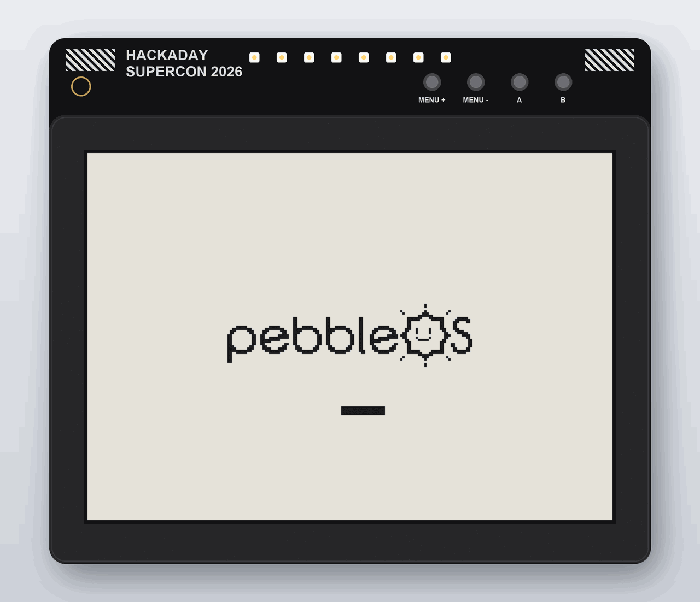
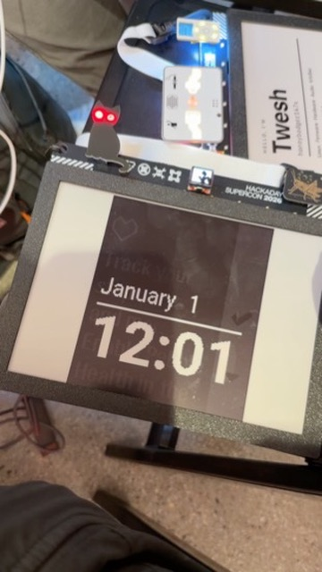

# PebbleOS on the Supercon 2026 badge



The [Hackaday Supercon 2026 Billboard badge](https://github.com/Hack-a-Day/2026-Billboard_Badge),
its ESP32-S3 and its 9.7" e-paper panel, running
[PebbleOS](https://github.com/coredevices/PebbleOS), the open-source Pebble
firmware. It boots to a Pebble watchface, pairs with the Pebble app on a
phone, shows your notifications, and runs watchfaces and apps from the Pebble
store.



*TicToc on the badge, on day one. Taken before the phone had set the clock,
hence January 1; the faint text behind the time is a ghost of the previous
screen, which this e-paper panel leaves.*

## Links

- **The badge:** [Hack-a-Day/2026-Billboard_Badge](https://github.com/Hack-a-Day/2026-Billboard_Badge),
  hardware, schematics and its original MicroPython firmware
- **PebbleOS:** [coredevices/PebbleOS](https://github.com/coredevices/PebbleOS),
  which this repository is a fork of, and its [documentation](https://pebbleos.readthedocs.io/latest)
- **The phone app:** Pebble Core, for [iPhone](https://apps.apple.com/us/app/pebble-core/id6743771967)
  and [Android](https://play.google.com/store/apps/details?id=coredevices.coreapp)
- **Firmware to install:** [Releases](https://github.com/devoopes/supercon10-badge-pebbleos/releases)

## Install it on your badge

You need a USB-C cable, Python, and about five minutes. Nothing else to
build or install.

1. **Install esptool**, Espressif's flashing tool:

   ```bash
   pip install esptool
   ```

2. **Download the firmware** from the
   [v0.1.0 release](https://github.com/devoopes/supercon10-badge-pebbleos/releases/tag/v0.1.0):
   `pebbleos-billboard-v0.1.0-full.bin`.

3. **Put the badge in its bootloader.** Plug it in, then hold **Boot**, tap
   **Reset**, and let go of **Boot**. The screen doesn't change.

4. **Find its port:** `ls /dev/cu.usbmodem*` on a Mac, `ls /dev/ttyACM*` on
   Linux, or a COM port in Device Manager on Windows. Below it is
   `/dev/cu.usbmodem101`; use yours.

5. **Back up the Supercon firmware**, so you can go back to it (about a
   minute):

   ```bash
   esptool --chip esp32s3 --port /dev/cu.usbmodem101 read-flash 0 ALL supercon-badge-backup.bin
   ```

6. **Install PebbleOS** (about a minute and a half):

   ```bash
   esptool --chip esp32s3 --port /dev/cu.usbmodem101 write-flash 0x0 pebbleos-billboard-v0.1.0-full.bin
   ```

7. **Tap Reset.** About ten seconds later the panel flashes, the PebbleOS
   loading screen appears, and then the watchface. The panel takes about a
   second for each change of screen.

### Using it

| Badge button | Pebble button |
| --- | --- |
| Menu + | Up |
| Menu − | Down |
| A | Select |
| B | Back |

**Pair your phone:** install Pebble Core, add a watch, and pick
**Pebble XXXX** (the last bytes of the badge's Bluetooth address). Accept the
pairing on the phone. The phone sets the time and timezone, sends
notifications, and installs watchfaces. **Decline any firmware update** the
app offers: those are for a real Pebble's chip.

### Updating

To install a newer release and keep your pairing, settings and apps, write
only the application image (the badge resets into its bootloader on its own
once it runs PebbleOS):

```bash
esptool --chip esp32s3 --port /dev/cu.usbmodem101 write-flash 0x10000 pebbleos-billboard-v0.1.0-app.bin
```

### Going back

```bash
esptool --chip esp32s3 --port /dev/cu.usbmodem101 write-flash 0x0 supercon-badge-backup.bin
```

Then tap **Reset**.

## What we did

PebbleOS runs on Pebble watches with ARM chips. The badge has an ESP32-S3,
whose Xtensa cores are not ARM, and a screen the size of a paperback.

**The trick.** PebbleOS can already run as an ordinary program on a computer,
its "native simulator": its kernel threads become the computer's threads,
and each driver is split into a firmware half and a small "bottom" half that
talks to the computer. Here [ESP-IDF](https://github.com/espressif/esp-idf),
Espressif's SDK, plays the computer: its FreeRTOS threads and C library stand
in, so the PebbleOS kernel runs unchanged. The whole firmware compiles for the
ESP32-S3 into one library, and a small ESP-IDF application links it and
provides the badge's bottoms.

**The panel.** Driving the 960 × 672 e-paper the way the badge firmware does
takes 31 seconds an update. Its short waveform, by the badge team, brings
that to 1.2 s; a tweak that repeats its black and white drive in the
waveform's idle slots gets solid black at no extra time. PebbleOS is a
144 × 168 Pebble 2 Duo ("Flint") here, drawn 4× (576 × 672, the panel's full
height) in the middle of the panel. Only changed pixels are driven, frames
are coalesced while the panel is busy, and the whole screen is cleaned every
40 updates.

**Bluetooth.** PebbleOS brings its own Bluetooth host, NimBLE; it talks to the
ESP32-S3's radio over the standard HCI interface, as it would to a separate
Bluetooth chip.

**Apps from the store** are ARM code. [Samsa](https://github.com/coredevices/samsa),
PebbleOS's ARM interpreter from its simulator, runs them on the ESP32-S3.

**Along the way**, three fixes in PebbleOS itself, each its own commit: a NULL
read that only crashes off ARM, never jumping into ARM code on other CPUs,
and moving 86 KB of Samsa's state out of scarce internal RAM.

## Where the code is

Everything is on the `billboard-badge` branch, on top of PebbleOS.

| Path | What |
| --- | --- |
| [`boards/billboard/`](boards/billboard) | The board: Kconfig, defconfig, devices |
| [`soc/posix/espidf/app/`](soc/posix/espidf/app) | The ESP-IDF application |
| `…/app/main/host.c` | `app_main` and the host services |
| `…/app/main/epd.c`, `display_bottom.c` | E-paper driver; scaling and partial updates |
| `…/app/main/input_bottom.c` | Buttons |
| `…/app/main/uart_bottom.c`, `bt_bottom.c` | USB console; HCI to the BLE radio |
| `…/app/main/flash_bottom.c` | PebbleOS's flash, a partition of the chip's |
| `…/app/main/gen_lut.py` | The panel waveform, generated from the badge firmware |
| `…/app/main/pebbleos.lf` | Linker placement: firmware data in PSRAM |
| [`include/pbl/board/partitions_billboard.h`](include/pbl/board/partitions_billboard.h) | Flash layout |
| [`cmake/toolchain/espidf-esp32s3.cmake`](cmake/toolchain/espidf-esp32s3.cmake) | Xtensa toolchain |
| [`drivers/flash/espidf.c`](drivers/flash/espidf.c) | Flash driver |
| [`third_party/billboard_badge/`](third_party/billboard_badge) | Submodule: the badge repository, for the waveform |

Nothing from elsewhere is copied in: ESP-IDF and the PebbleOS SDK are
installed, and other repositories come in as git submodules.

## Build it yourself

On a Mac with Apple silicon, which is what this was built and tested on.

1. **Clone with submodules:**

   ```bash
   git clone --recurse-submodules --shallow-submodules https://github.com/devoopes/supercon10-badge-pebbleos.git
   ```

2. **Homebrew packages and the Python environment**, in the clone:

   ```bash
   brew install $(cat requirements-brew.txt) && python3 -m venv .venv && .venv/bin/pip install -r requirements.txt
   ```

3. **ESP-IDF v5.5.2**, in `~/esp`:

   ```bash
   mkdir -p ~/esp && cd ~/esp && curl -fLO https://dl.espressif.com/github_assets/espressif/esp-idf/releases/download/v5.5.2/esp-idf-v5.5.2.zip && unzip -q esp-idf-v5.5.2.zip && cd esp-idf-v5.5.2 && ./install.sh esp32s3
   ```

4. **The PebbleOS SDK**, for the ARM toolchain Samsa's build uses:

   ```bash
   curl -LsSf https://github.com/coredevices/PebbleOS-SDK/releases/latest/download/pebbleos-sdk-installer.sh | sh
   ```

5. **Build the firmware, then the application.** ESP-IDF's environment comes
   first for the first step, and the PebbleOS one must be off for the second:

   ```bash
   . ~/esp/esp-idf-v5.5.2/export.sh && source .venv/bin/activate && pbl -b build-badge configure --board billboard && cmake --build build-badge && deactivate
   ```

   ```bash
   cd soc/posix/espidf/app && . ~/esp/esp-idf-v5.5.2/export.sh && idf.py -B ../../../../build-badge-idf build
   ```

6. **Flash** everything (bootloader, partition table, application, system
   resources) from `build-badge-idf`. The first time, erase the old
   MicroPython files first with `erase_region 0x320000 0x4e0000`.

   ```bash
   cd build-badge-idf && . ~/esp/esp-idf-v5.5.2/export.sh && esptool.py --chip esp32s3 -p /dev/cu.usbmodem101 -b 921600 write_flash @flash_args
   ```

The USB port is also the PebbleOS console, with its `pebble>` shell; on a Mac,
connecting to it resets the badge.

## Troubleshooting

| Symptom | Cause |
| --- | --- |
| esptool: "No serial data received" | The badge isn't in its bootloader: hold Boot, tap Reset, let go |
| Screen unchanged after flashing | Tap Reset |
| esptool: port busy | Something else has the port open, such as a serial monitor |
| The phone doesn't find the badge | Wait for the watchface; it advertises once booted |
| Faint ghosts of the previous screen | The e-paper; they clear within a few updates |
| `idf.py`: "No module named esp_idf_monitor" | The PebbleOS Python environment is active: `deactivate` |
| `configure`: "ESP-IDF not found" | Source ESP-IDF's `export.sh` first |
| `idf.py`: "rendered_luts.py is missing" | `git submodule update --init third_party/billboard_badge/2026-Billboard_Badge` |

## Not done yet

- The ghosting: the short waveform leaves a light trace where pixels go white.
- The 192 px either side of the watch screen are unused.
- Without power the clock is lost, until the phone reconnects.
- Red, and the bigger colour Pebbles (Emery, Gabbro).

## Credits

The badge, its panel driver sequences and the short waveform are by Hackaday
and the Supercon badge team. PebbleOS, Samsa and the Pebble app are by
[Core Devices](https://github.com/coredevices) and the Pebble community,
Apache-2.0. PebbleOS's own README and resources are in
[the upstream repository](https://github.com/coredevices/PebbleOS).
