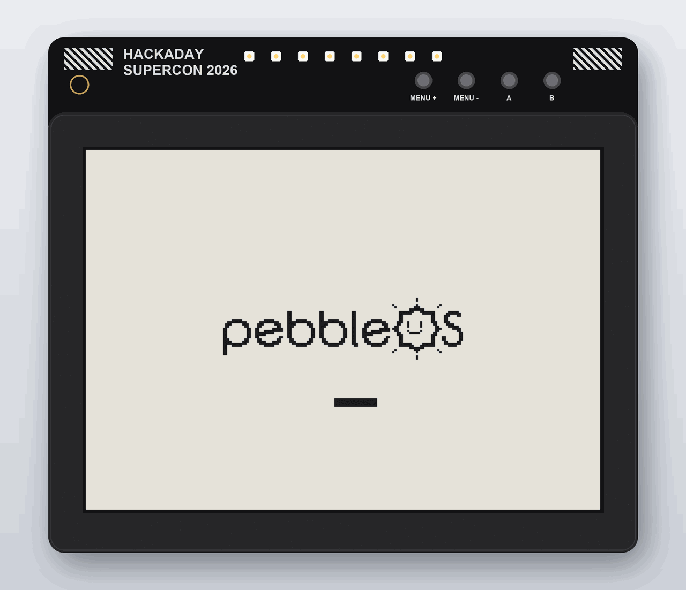
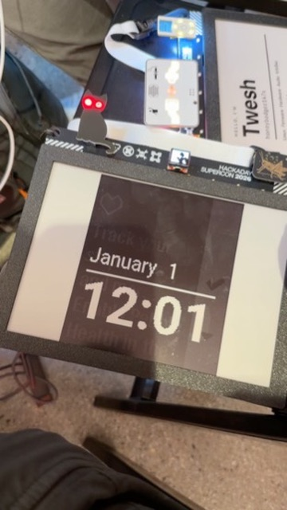

# PebbleOS on the Hackaday Billboard badge



*A rendering of the badge booting PebbleOS: the 144 × 168 Flint screen, 4× on
the 9.7" e-paper panel. Drawn by [`doc/render_badge.py`](doc/render_badge.py)
from a frame of the simulator ([`doc/boot-frame.png`](doc/boot-frame.png)).*

The [Hackaday Supercon 2026 Billboard badge](https://github.com/Hack-a-Day/2026-Billboard_Badge)
runs PebbleOS as a Pebble 2 Duo ("Flint"): the watchfaces, the launcher,
Timeline, Health, settings, pairing with the Pebble app on a phone,
notifications, music control, and apps and watchfaces from the store.



*The real thing, on its first day: TicToc on the badge. It was taken before
the phone had set the clock, hence January 1; the faint text behind the time
is a ghost of the previous screen, which e-paper leaves (see below).*

| | |
| --- | --- |
| Chip | ESP32-S3, 8 MiB flash, 8 MiB octal PSRAM |
| Display | Pervasive Displays E2969JS0B1, 960 × 672, black/white/red e-paper |
| PebbleOS platform | Flint, 144 × 168 black and white, drawn 4× and centred |
| Screen update | about 1.2 s; changed pixels only |
| Buttons | Menu + → Up, Menu − → Down, A → Select, B → Back |
| Bluetooth | the chip's BLE radio, driven by PebbleOS's own NimBLE host |
| Phone app | [Pebble Core](https://apps.apple.com/us/app/pebble-core/id6743771967) (iOS) or [Google Play](https://play.google.com/store/apps/details?id=coredevices.coreapp) |

## How it works

PebbleOS can already run as an ordinary program on a computer (the
[native simulator](../../docs/development/emulation/native_simulator.md)):
its kernel threads are host threads, and each driver is split into a
firmware half and a small "bottom" half that talks to the host. Here the host
is [ESP-IDF](https://github.com/espressif/esp-idf): its FreeRTOS pthreads and
newlib stand in for a computer's, so the kernel runs unchanged
(`CONFIG_POSIX_ESPIDF`).

The firmware is built with ESP-IDF's Xtensa compiler into one library,
`libpebbleos.a`. A small ESP-IDF application links it and provides the
bottoms: the USB console, the e-paper panel, the buttons, the flash, and the
BLE controller. Apps from the store are Thumb-2 code, which
[Samsa](https://github.com/coredevices/samsa) interprets.

## Where the code is

Everything is on the `billboard-badge` branch.

| Path | What |
| --- | --- |
| [`boards/billboard/`](.) | The board: Kconfig, defconfig, devices (`billboard.c`) |
| [`include/pbl/board/partitions_billboard.h`](../../include/pbl/board/partitions_billboard.h) | Flash layout inside the "pebble" partition |
| [`cmake/toolchain/espidf-esp32s3.cmake`](../../cmake/toolchain/espidf-esp32s3.cmake) | Xtensa toolchain, against ESP-IDF's libc headers |
| [`cmake/modules/firmware.cmake`](../../cmake/modules/firmware.cmake) | `pbl_link_espidf()`: the firmware as `libpebbleos.a` |
| [`drivers/flash/espidf.c`](../../drivers/flash/espidf.c) | Flash driver over an ESP-IDF partition |
| [`soc/posix/espidf/app/`](../../soc/posix/espidf/app) | The ESP-IDF application |
| `…/app/main/host.c` | `app_main`, the host services, pthread cleanup handlers |
| `…/app/main/epd.c`, `display_bottom.c` | E-paper driver; scaling, coalescing and partial updates |
| `…/app/main/gen_lut.py` | Generates the panel's waveform table from the badge firmware, at build time |
| `…/app/main/input_bottom.c` | Buttons |
| `…/app/main/uart_bottom.c`, `bt_bottom.c` | USB console; HCI to the BLE controller over VHCI |
| `…/app/main/flash_bottom.c` | The "pebble" partition |
| `…/app/main/pebbleos.lf` | Linker fragment: firmware data in PSRAM, registries in flash |
| `…/app/partitions.csv`, `sdkconfig.defaults` | ESP-IDF partitions and settings |
| [`third_party/billboard_badge/`](../../third_party/billboard_badge) | Submodule: Hackaday's badge repository, for the waveform |

Nothing from elsewhere is copied in. ESP-IDF and the PebbleOS SDK are
installed, and code from other repositories comes in as git submodules, which
the repository only points at.

## What you need

On a Mac with Apple silicon, which is what this was built and tested on:

0. **The submodules.** PebbleOS's own, and the badge firmware's, which holds
   the panel's waveform:

   ```bash
   git submodule update --init --recursive --depth 1
   ```

1. **Homebrew packages** for the PebbleOS build:

   ```bash
   brew install $(cat requirements-brew.txt)
   ```

2. **The Python environment**, from the top of the repository:

   ```bash
   python3 -m venv .venv && .venv/bin/pip install -r requirements.txt
   ```

3. **ESP-IDF v5.5.2**, in `~/esp`:

   ```bash
   mkdir -p ~/esp && cd ~/esp && curl -fLO https://dl.espressif.com/github_assets/espressif/esp-idf/releases/download/v5.5.2/esp-idf-v5.5.2.zip && unzip -q esp-idf-v5.5.2.zip && cd esp-idf-v5.5.2 && ./install.sh esp32s3
   ```

4. **The PebbleOS SDK**, for its ARM toolchain, which Samsa's build uses
   (see the [getting started guide](../../docs/getting_started/index.md)):

   ```bash
   curl -LsSf https://github.com/coredevices/PebbleOS-SDK/releases/latest/download/pebbleos-sdk-installer.sh | sh
   ```

## Back up the badge first

Flashing replaces the Supercon firmware. Keep a copy of the whole flash to go
back to. Put the badge in its bootloader (hold **Boot**, tap **Reset**,
release **Boot**), then:

```bash
. ~/esp/esp-idf-v5.5.2/export.sh && esptool.py --chip esp32s3 -p /dev/cu.usbmodem101 read_flash 0 0x800000 badge-factory.bin
```

The port name varies; `ls /dev/cu.usbmodem*` lists it.

## Build

Two steps: the firmware, then the ESP-IDF application that links it. ESP-IDF's
environment has to be loaded before the PebbleOS one for the first, and
without it for the second, or `idf.py` picks up the wrong Python.

```bash
. ~/esp/esp-idf-v5.5.2/export.sh && source .venv/bin/activate && pbl -b build-badge configure --board billboard && cmake --build build-badge && deactivate
```

```bash
cd soc/posix/espidf/app && . ~/esp/esp-idf-v5.5.2/export.sh && idf.py -B ../../../../build-badge-idf build
```

`configure` is only needed the first time, or after changing a Kconfig file.

## Flash

### The first time

Erase the "pebble" partition, which still holds the badge's old MicroPython
files, then write everything: bootloader, partition table, application and
the system resources.

```bash
. ~/esp/esp-idf-v5.5.2/export.sh && esptool.py --chip esp32s3 -p /dev/cu.usbmodem101 erase_region 0x320000 0x4e0000
```

```bash
cd build-badge-idf && . ~/esp/esp-idf-v5.5.2/export.sh && esptool.py --chip esp32s3 -p /dev/cu.usbmodem101 -b 921600 --before default_reset --after watchdog_reset write_flash @flash_args
```

If the badge is still running the Supercon firmware, it may not reset into
its bootloader on its own: hold **Boot**, tap **Reset**, release **Boot**
first. Once it runs PebbleOS, flashing resets it by itself.

### Updating

To update after pulling new code, build both steps again, then write only the
application. Settings, the pairing with your phone and installed apps live in
the "pebble" partition, and stay.

```bash
cd build-badge-idf && . ~/esp/esp-idf-v5.5.2/export.sh && esptool.py --chip esp32s3 -p /dev/cu.usbmodem101 -b 921600 --before default_reset --after watchdog_reset write_flash 0x10000 pebbleos_billboard.bin
```

If the system resources changed (fonts, images, languages:
`build-badge/system_resources.pbpack`), write them too, at `0x330000`, or
use the first-time command, which writes both. esptool may report an error
as it resets the badge at the end; the image was written and verified by then.

## Pair with a phone

1. Install the Pebble Core app.
2. Add a watch in the app; the badge advertises as **Pebble XXXX**, after the
   last bytes of its Bluetooth address.
3. Accept the pairing on the phone, and on the badge if it asks (A).
4. **Decline firmware updates.** They are for a real Pebble's chip.

The phone sets the time and timezone, sends notifications, and installs
watchfaces and apps.

## Console

The USB port is also the PebbleOS console, with its `pebble>` shell, at
115200 baud. Connecting to it on a Mac resets the badge.

Without a phone, the clock can be set from there: `time set <unix time>`. It
keeps time across resets, but not when the badge loses power.

## Go back to the Supercon firmware

```bash
. ~/esp/esp-idf-v5.5.2/export.sh && esptool.py --chip esp32s3 -p /dev/cu.usbmodem101 write_flash 0x0 badge-factory.bin
```

## Troubleshooting

| Symptom | Cause |
| --- | --- |
| `idf.py`: "No module named esp_idf_monitor" | The PebbleOS Python environment is active; `deactivate` it |
| `configure`: "ESP-IDF not found" | ESP-IDF's `export.sh` was not sourced first |
| `configure`: "needs the ARM toolchain of the PebbleOS SDK" | Install the SDK (Samsa needs it) |
| `idf.py`: "rendered_luts.py is missing" | The badge submodule is not checked out: `git submodule update --init` |
| esptool: port busy | Something has the console open; close it |
| esptool: "No serial data received" | The badge did not enter its bootloader: Boot + Reset |
| Boot loop, `pthread: Failed to create task!` | Internal RAM ran out for thread stacks; see `idf.py size` |
| Faint ghosts of the previous screen | E-paper; the whole screen is cleaned every 40 updates |

## Not done yet

- Ghosting: the short waveform leaves a light trace where pixels go to white.
- The 192 px either side of the watch screen are unused.
- The clock is lost without power until the phone reconnects.
- Red, and the larger colour platforms (Emery, Gabbro), are not used.

## Credits

The e-paper command sequences and the short waveform come from the badge's
own firmware, by Hackaday and the Supercon badge team
([Hack-a-Day/2026-Billboard_Badge](https://github.com/Hack-a-Day/2026-Billboard_Badge)).
